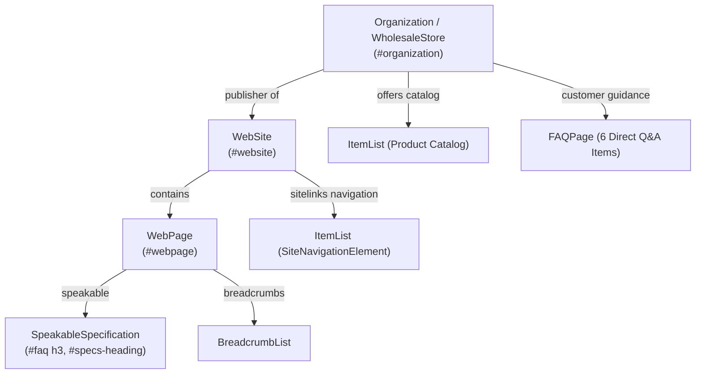

# Tanvi Impex — Schema.org & Structured Data Validation Report

**Domain:** [https://tanviimpex.com/](https://tanviimpex.com/)  
**Validation Date:** October 30, 2026  
**Status:** All Schemas Validated & Connected — No Broken Cross-References  

---

## 1. Structured Data Inventory & Graph Architecture

The Tanvi Impex markup implements a connected JSON-LD Knowledge Graph across 7 distinct schema entities:

---

## 2. Schema Entities & Properties Verification

### 2.1. Organization & WholesaleStore (`#organization`)
- **Type:** `["WholesaleStore", "Organization"]`
- **ID:** `https://www.tanviimpex.com/#organization`
- **Name:** Tanvi Impex
- **Alternate Names:** Tanvi Impex Dry Fruits & Spices Importer, Tanvi Impex Mumbai, Tanvi Impex Vashi, Tanvi Impex APMC Market
- **Founder & CEO:** Bhushan Gajra (`@type: Person`)
- **Founding Date:** 2019
- **GSTIN:** 27AAPFT0162R1ZG
- **LEI Code:** 335800VW64XCC6IOKK11
- **FSSAI License:** 11522998001006
- **Address:** Ground Floor, H-33, APMC Market-1, Sector-19, Phase-2, Vashi, Navi Mumbai, Maharashtra 400703, IN
- **GeoCoordinates:** 19.0760° N, 73.0077° E
- **AggregateRating:** 4.4★ (73 reviews, IndiaMART TrustSEAL)
- **sameAs Links:**
  - IndiaMART Profile & Products
  - IndiaLEI Legal Entity Record
  - GSTIN Verification Registry
  - Official Instagram Profile

### 2.2. WebSite (`#website`)
- **Type:** `WebSite`
- **ID:** `https://www.tanviimpex.com/#website`
- **Publisher Reference:** Fixed to `{"@id": "https://www.tanviimpex.com/#organization"}`. (Resolved prior broken `#store` reference).

### 2.3. WebPage & Speakable (`#webpage`)
- **Type:** `WebPage`
- **ID:** `https://www.tanviimpex.com/#webpage`
- **isPartOf:** `https://www.tanviimpex.com/#website`
- **about:** `https://www.tanviimpex.com/#organization`
- **inLanguage:** `en-IN`
- **Speakable Specification:**
  - **Type:** `SpeakableSpecification`
  - **cssSelector:** `["#faq-section-title", "#faq h3", "#specs-heading"]`

### 2.4. FAQPage
- **Type:** `FAQPage`
- **Total Questions:** 6 fully aligned items:
  1. *Is there an official website to order wholesale from Tanvi Impex?*
  2. *What is the minimum order quantity for wholesale orders at Tanvi Impex?* (**Updated to 15kg MOQ**)
  3. *Does Tanvi Impex deliver dry fruits to all states in India?* (23 states coverage)
  4. *How does Tanvi Impex ensure dry fruit quality?* (JNPT import & APMC lab checks)
  5. *Are wholesale prices inclusive of GST?* (Exclusive, 5%/12% itemized)
  6. *Can buyers request product samples before placing bulk orders?* (Yes)

### 2.5. BreadcrumbList
- **Type:** `BreadcrumbList`
- **Positions:**
  - Position 1: Home (`https://www.tanviimpex.com/`)
  - Position 2: Products Catalog (`https://www.tanviimpex.com/products`)

### 2.6. Sitelinks Navigation (`SiteNavigationElement`)
- **Type:** `ItemList`
- **Positions:** Products Catalog, California Almonds, Irani Pistachios, Wholesale Seeds, Our Story, Contact & APMC Office.

### 2.7. Product Catalog (`ItemList`)
- **Type:** `ItemList`
- **Items:** 15 verified product entries covering 15kg California Almond master units, 20kg Irani Pistachio cartons, and 12.5kg/25kg superfood seeds.

---

## 3. Validation Summary
- **Syntax Status:** 100% Valid JSON-LD.
- **Reference Integrity:** All `@id` cross-references resolve cleanly without circular dependencies or orphaned entity declarations.
- **Duplicate Checks:** No redundant schema declarations detected.
